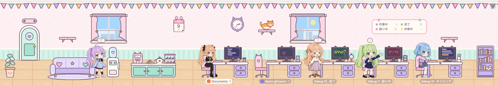
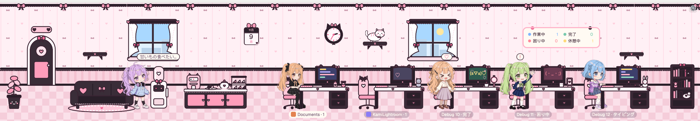
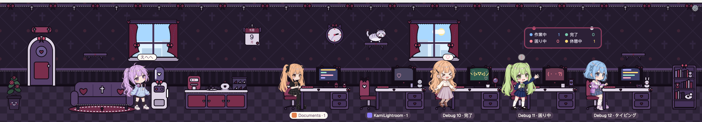

# Moe Office

[English](README.md) · [繁體中文](README.zh-TW.md) · **日本語**

[Herdr](https://herdr.dev) 用のかわいいオフィス mod です。agent ひとりひとりが自分のデスクを持つ女の子になって、みんなが今なにをしているか一目でわかります。





## みんなの様子

- **作業中**：デスクでタイピング。画面のコードが一行ずつ流れていきます。
- **困り中**：立ち上がって手を挙げて助けを呼びます。画面には「？」の顔文字。5 分たつと泣きながら「助けて」と叫び、画面はピンクに点滅して泣き顔に、名札も光ります。
- **完了**：バンザイして、画面にはごきげんな顔文字。あなたが見に行くまで続きます。
- **待機中**：ウォーターサーバーのそばでおしゃべり。10 分たつと、ソファでお昼寝、おしゃべり、お水、おやつを順番に。
- 新しい agent はドアから入ってきて、閉じた agent は箱を抱えて帰っていきます。
- サブ agent はインターンで、上司のデスクのそばに座ります。
- 5 分以内に 3 人が作業を終えると、ケーキが届いてお茶会に。
- デスクにはそれぞれの子の小物：ぬいぐるみ、いちごミルク、ティーカップ……
- 毎正時、ウォーターサーバーのそばで*あなた*に水分補給をうながす吹き出しが出ます。飲んだら「飲んだよ！」を押してください。
- カレンダーで今日の日付がわかります。窓はぜんぶ同じ景色で、太陽（月）はひとつだけ。
- 猫が住んでいます。壁のキャットステップに登ったり、空いた机や本棚の上で昼寝したりします。暗くなると明かりが落ちます。
- agent はそれぞれ何人かの女の子のうちの 1 人。初めて現れたときにランダムで決まり、Herdr を再起動しても変わりません。髪の色は 16 色。

## 操作

- 女の子にマウスを乗せる：今なにをしているか（と git のブランチ）を表示します。
- 女の子かデスクをクリック：その子のターミナルへ移動します。
- 右上の ⚙️：設定。いちばん上で言語とシーン（パステルオフィス、レースとリボンいっぱいのピンク×黒の地雷系、またはダークモード向けのゴスロリ）を選べます。「デバッグモード」にチェックを入れると、ダミーの同僚を追加して、キャラや髪色を変えたり、サブ agent をつけたり、リモート勤務（ビデオ会議）にしたり、時間帯を切り替えたり、お茶会や水分補給の吹き出しをすぐ出したりできます。

## インストール

1. このリポジトリを取得して、mod を Herdr に入れます（`~/.config/herdr-app/mods/moe-office` に入ります）：

   ```
   git clone https://github.com/kamikuo/herdr-moe-office.git && cd herdr-moe-office && ./install.sh
   ```

2. レイアウト（`~/.config/herdr-app/layouts/<名前>.json`）にオフィス用のブロックを追加します。たとえばタブバーの下に、高さ 250 px で：

   ```json
   { "id": "office", "type": "block", "content": { "mod": "moe-office" }, "size": { "px": 250 }, "min": 170, "max": 520 }
   ```

   オフィスと下のペインの境目をドラッグして高さを変えるには、オフィスが入っている row / column に `"resizable": false` を付けないでください（何も書かなければドラッグできます）。ドラッグした高さは Herdr が覚えています。`min` と `max` がドラッグできる範囲です。オフィスの中のものは高さに合わせて拡大・縮小します。

Herdr の中の agent にリポジトリの URL を渡して、インストールを頼むこともできます。

## 言語

オフィスの表示は最初は英語です。⚙️ 設定の 🌐 ボタンで日本語や繁体字中国語に切り替えられます（選んだ言語は保存されます）。

レイアウトで指定することもできます。ブロックの `props` に `lang` を追加します（⚙️ で選んだ言語が優先されます）：

```json
{ "id": "office", "type": "block", "content": { "mod": "moe-office", "props": { "lang": "ja" } }, "size": { "px": 250 } }
```

`lang` には `en`、`zh-TW`、`ja` を指定できます。シーンも同じように指定できます：`"scene": "pastel"`、`"jirai"`、`"gothic"` のどれか。

## プライバシー

- プログラムは実行せず、ネットにもつながりません。

## 開発

mod の改造や新しいキャラクターの作り方は [AGENTS.md](AGENTS.md)（英語）にあります。
