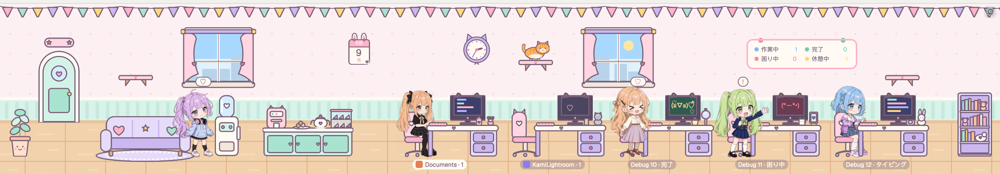
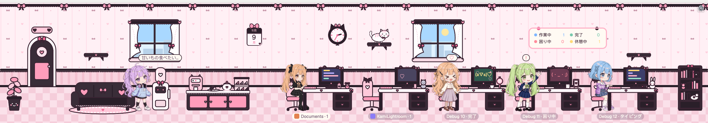
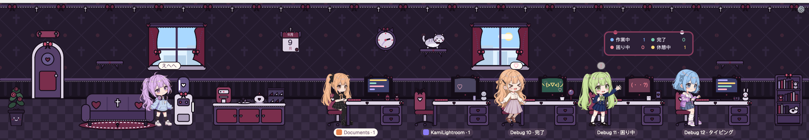

# Moe Office

**English** · [繁體中文](README.zh-TW.md) · [日本語](README.ja.md)

A cute office mod for [Herdr](https://herdr.dev): every agent is a girl with her own desk, so you can see at a glance what everyone is up to.





## What they do

- **Working**: typing at her desk, lines scrolling up her screen.
- **Stuck**: she stands up and waves for help; a puzzled face on her screen. After 5 minutes she cries for help, her screen flashes pink with a crying face, and her name tag flashes too.
- **Done**: cheering, with happy faces on her screen, until you go and look.
- **Idle**: chatting at the water cooler; after 10 minutes she takes turns napping on the couch, chatting, drinking water and having a snack.
- New agents walk in through the door; closed ones leave carrying a box.
- Sub-agents are interns, sitting by their boss's desk.
- When 3 agents finish within 5 minutes, a cake arrives for tea time.
- Each girl's desk has her own things: a plushie, strawberry milk, a teacup…
- At the top of every hour a bubble at the water cooler reminds *you* to drink some water; press "I drank it!" when you have.
- A calendar shows today; the windows share one view with one sun (or moon).
- There's a cat: she climbs the cat shelves on the wall and naps on empty desks or the bookshelf. The lights go down after dark.
- Each agent is one of several girls, picked at random when she first shows up and kept after restarts, with one of 16 hair colours.

## Using it

- Hover a girl: see what she's working on (and the git branch).
- Click her or her desk: jump to her terminal.
- The ⚙️ in the top right corner: settings. Pick the language and the scene (the pastel office, pink-and-black jirai-kei with lace and ribbons, or a dark gothic lolita room for dark mode) here; tick "Debug mode" to add fake coworkers, switch their character and hair colour, give them sub-agents or send them home (the video call), try other times of day, and start tea time or the water reminder.

## Install

1. Get this repo and install the mod into Herdr (it goes to `~/.config/herdr-app/mods/moe-office`):

   ```
   git clone https://github.com/kamikuo/herdr-moe-office.git && cd herdr-moe-office && ./install.sh
   ```

2. Add a block for the office to your layout (`~/.config/herdr-app/layouts/<name>.json`), for example under the tab bar, 250 px tall:

   ```json
   { "id": "office", "type": "block", "content": { "mod": "moe-office" }, "size": { "px": 250 }, "min": 170, "max": 520 }
   ```

   To change its height by dragging the edge between the office and the panes, the row or column it sits in must not have `"resizable": false` (resizable is the default). Herdr remembers the height you drag it to; `min` and `max` keep it in range. Everything in the office scales with the height.

You can also ask an agent in Herdr to install it for you: just give it this repo's URL.

## Language

The office speaks English by default. Switch to Traditional Chinese or Japanese with the 🌐 button in the ⚙️ panel; it's remembered.

Or set it in the layout, by adding `lang` to the block's `props` (the ⚙️ choice wins over this):

```json
{ "id": "office", "type": "block", "content": { "mod": "moe-office", "props": { "lang": "ja" } }, "size": { "px": 250 } }
```

`lang` can be `en`, `zh-TW` or `ja`. The scene can be set the same way: `"scene": "pastel"`, `"jirai"` or `"gothic"`.

## Privacy

- It runs no programs and never goes online.

## Development

How to change the mod or make a new character: [AGENTS.md](AGENTS.md).
