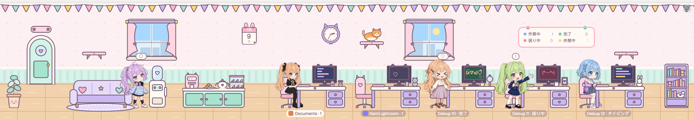
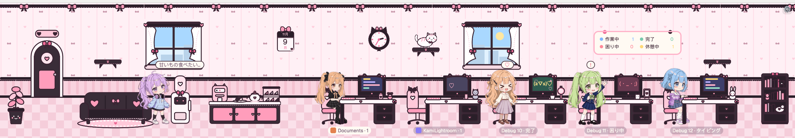
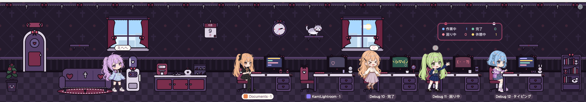

# Moe Office

[English](README.md) · **繁體中文** · [日本語](README.ja.md)

[Herdr](https://herdr.dev) 的萌系辦公室 mod：每個 agent 是一個女孩，有自己的桌子，你一眼就看得出大家在忙什麼。





## 她們在做什麼

- **工作中**：坐在桌前打字，螢幕上的程式碼一行行往上捲。
- **卡住**：站起來舉手求救；螢幕上是疑惑的表情。卡超過 5 分鐘會哭著喊救命，螢幕閃粉紅色換成哭臉，名牌也跟著閃。
- **完成**：開心歡呼，螢幕上是可愛的顏文字，直到你去看她。
- **閒置**：在飲水機旁聊天；閒置超過 10 分鐘，就輪流到沙發午睡、聊天、喝水、吃點心。
- 新的 agent 會從門口走進來，關掉的 agent 會抱著箱子離開。
- 子 agent 是實習生，坐在上司的桌子旁邊。
- 5 分鐘內有 3 個 agent 完成工作，就會送蛋糕來開下午茶。
- 每個女孩桌上都有自己的小東西：玩偶、草莓牛奶、茶杯……
- 每個整點，飲水機旁會冒出泡泡提醒*你*喝水，喝完按「我喝完了！」就會收起來。
- 牆上的月曆顯示今天；所有窗戶看出去是同一片風景，只有一個太陽（或月亮）。
- 辦公室裡有一隻貓：會爬上牆上的貓跳板，也會在空桌或書櫃頂上睡覺。天黑了會關燈。
- 每個 agent 會是其中一位女孩：第一次出現時隨機決定，重開 Herdr 也不會變；髮色共 16 種。

## 操作

- 滑鼠移到她身上：看她正在做什麼（還有 git branch）。
- 點她或她的桌子：跳到她的終端機。
- 右上角的 ⚙️：設定。最上面選語言和場景（粉彩辦公室、滿是蕾絲和蝴蝶結的粉黑地雷系，或適合深色模式的哥德蘿莉）；勾選「Debug 模式」後可以加假角色、換角色和髮色、幫她們加子 agent 或讓她們遠端上班（視訊牆）、切換時間，也能直接開下午茶或跳出喝水提醒。

## 安裝

1. 下載這個 repo，把 mod 裝進 Herdr（會放到 `~/.config/herdr-app/mods/moe-office`）：

   ```
   git clone https://github.com/kamikuo/herdr-moe-office.git && cd herdr-moe-office && ./install.sh
   ```

2. 在你的版面（`~/.config/herdr-app/layouts/<名稱>.json`）裡加一個區塊放辦公室，例如放在分頁列下面、高 250 px：

   ```json
   { "id": "office", "type": "block", "content": { "mod": "moe-office" }, "size": { "px": 250 }, "min": 170, "max": 520 }
   ```

   想用拖曳辦公室和下方窗格之間的邊界來調整高度，辦公室所在的那一層（row 或 column）不能設 `"resizable": false`（預設就可以拖）。拖好的高度 Herdr 會記住；`min`、`max` 是可拖的範圍。辦公室裡的東西會跟著高度一起縮放。

也可以直接請 Herdr 裡的 agent 幫你裝：把這個 repo 的網址給它就好。

## 語言

辦公室預設是英文。在 ⚙️ 設定裡按 🌐 就能切成繁體中文或日文，選了會記住。

也可以寫在版面裡：在區塊的 `props` 加上 `lang`（⚙️ 裡選的語言優先）：

```json
{ "id": "office", "type": "block", "content": { "mod": "moe-office", "props": { "lang": "zh-TW" } }, "size": { "px": 250 } }
```

`lang` 可以是 `en`、`zh-TW` 或 `ja`。場景也可以用同樣的方式指定：`"scene": "pastel"`、`"jirai"` 或 `"gothic"`。

## 隱私

- 不會執行任何程式，也不會連上網路。

## 開發

改 mod 或做新角色的說明在 [AGENTS.md](AGENTS.md)（英文）。
