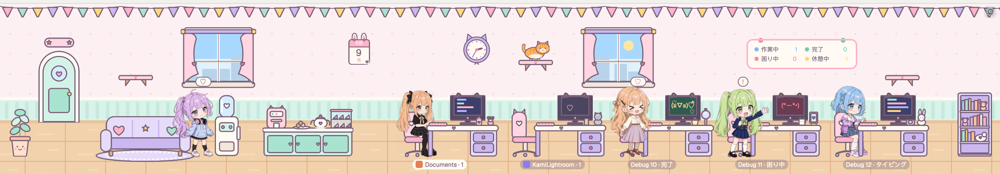

# Moe Office

A cute office in a strip across the top of the window: every agent is a chibi anime girl with her own desk, so you see at a glance who is typing, who is stuck, who finished and who is on a break. She walks in through the door when the agent starts, waves for help when it's blocked, cheers with a happy face on her screen when it's done, chats at the water cooler when idle, and after a while takes turns napping on the couch, chatting, drinking water and having a snack.

## What you see

A block about 250 px tall (170 to 520 when dragged), scaled from its height: one scene unit U = height / 68, between 2 and 6 px. Left to right:

- **A potted plant** with a smiling pot, in the corner.
- **The door** (17 × 29 U, arched), with a little sign over it. It opens for a moment when someone comes in or leaves.
- **The lounge**, first thing past the door: a couch on a rug, a water cooler, and a counter with a cat-eared coffee machine, a plate of cookies, a tea set and a dessert case.
- **The desks**, one per agent (at least 3), 38 U apart (up to 44 when there's room). As many as fit go in the front row; the rest in a second row behind, half a desk to the right and 10 U higher. Each desk has a cat-eared monitor, a chair behind the girl, two desk things of her own by character (jirai: strawberry milk and a bear with a bow; intern: a juice box and a pencil cup; designer: a cup of tea and a tulip; engineer: an energy drink and a cat plush; wavy hair: a pudding and a hand mirror; twin tails: a cat mug and a photo frame; bob: a handheld game and a bunny plush; an empty desk has a lamp), and under the desk a name tag: the space's colour tile from the sidebar and `space · tab`, light when her pane is the focused one.
- **A bookshelf** against the right end, with books and plushies.

The plant, the door and the bookshelf stay in the corners; the room in between is shared out: the lounge's gaps widen a little (up to 6 U each), the desks spread a little (up to 6 U), and the rest goes evenly on both sides of the desks, so they sit in the middle. Resizing stretches everything smoothly.
- **On the wall**: bunting along the top; then, from the door to the bookshelf and evenly spaced: a window, a tear-off calendar with today's month, date and weekday (the clock's size and height; bunny ears in the pastel office, a big pink bow over a black header in jirai-kei, bat wings, a cross and a rose in gothic), a cat clock with real hands, a window, a team board (Working, Done, Stuck, Break, and when there are any Napping, Interns and Tea time), the video call when there are remote agents, and more windows while the gaps stay at least 40 U wide. Three little cat shelves with a paw print, in the gaps when they're wide enough: the first (by the door), the middle one (a little higher) and the last (by the bookshelf). All windows look out on one landscape: the sky for the time of day, a single sun or moon, clouds drifting across the whole room, and a skyline (lit windows at night).
- **The girls**: seven characters cut from anime videos (a jirai-kei girl in black, a sailor-uniform intern, a girl in a blue dress with a sketchbook, an engineer in a hoodie with headphones, a girl with long wavy hair in a white blouse, a girl with twin tails in a navy blazer who holds a cat mug while idle, a girl with a short bob in a lilac jacket), each in one of 16 hair colours. Each agent gets a character at random the first time she shows up (one of those used least) and keeps it across restarts. The hair colour comes from the agent's address, unless someone in the office is already the same character with that colour: then she gets a colour none of them has. Both are kept in localStorage (`moe-office.cast`).
- **The cat**: an orange tabby in the pastel office, white with pink stripes in jirai-kei, silver-lilac in gothic. She wanders the floor, naps on empty desks, and sits or naps up on the cat shelves or on top of the bookshelf. She never flies: she walks along the floor to under her spot and hops straight up, and hops straight down before walking off.
- **A ⚙️ in the top right** opens the settings panel.

Three scenes, same layout, picked in the settings:

- **Pastel office** (default): wall `#fdf0f3` with faint stars and hearts, mint wainscot `#d9f2ea`, wood floor `#f2d2ad`, lavender desks, pink chairs, plum outlines `#7a6178`.
- **Jirai-kei**: light pink wall `#fff0f5` with tiny bows, pink wainscot with a black rail and black lace, a soft pink checkered floor, black desks, couch and door with white lace trims and pink bows everywhere.
- **Gothic lolita** (for dark mode): wall `#241b2d` with faint diamonds and crosses, a dark checkered floor, plum and wine furniture, silver-white lace, crosses and roses, wine velvet curtains, a dark board. The night dimming is halved.

The language is English, Traditional Chinese or Japanese for all text (board, bubbles, chat, settings).

## How it behaves

- **Working**: she sits typing at her desk; the screen is a terminal filling up: four coloured lines from the left edge with random lengths; the bottom one types itself out left to right, then they all scroll up a line and a new one starts (about two lines a second).
- **Blocked**: she stands and waves with a red `!` bubble; the screen cycles puzzled faces (`(・_・?)`, `(・_・;)`…). After 5 minutes she cries for help: a bigger blinking "😭 Help!!" bubble, crying faces on the screen (`(╥_╥)`, `(ToT)/`…) over a pink flash, and her name tag flashes pink.
- **Done**: she cheers (jumping, arms up) with a `♡` bubble; the screen cycles happy faces (`(≧▽≦)`, `ヽ(>▽<)ノ`…) with twinkling hearts, until you look at it (it becomes idle).
- **Idle**: she walks to the water cooler and chats (bubbles cycling short lines like "I want something sweet…", "nice weather ☀️"), alternating sides around it. After 10 minutes idle she takes turns, 3 minutes each, through nap, nap, snack, chat, nap, water (each girl starts at her own place in the list): a nap on the couch with "zZz" (up to 3; the rest chat instead), a snack at the counter ("🍪", "macaron ♡"…), a chat at the cooler, or a drink of water there ("gulp gulp", "so cold!"…). A debug coworker set to sleep always naps.
- **Water reminder**: for the first 3 minutes of every hour a "💧 Water break!" bubble floats over the cooler, for you. Its "I drank it!" button hides it until the next hour (remembered in localStorage, `moe-office.water`).
- **New agent**: she walks in from the door to her desk; desks are handed out lowest free first and never swap. **Closed agent**: she walks out the door carrying a moving box, and her desk goes: the desks after it move up one, in the same order, and their girls walk over, so no empty desk is left in the row (there are still at least 3 desks).
- **Sub-agents** are interns: smaller girls on stools in front of their parent's desk (up to 3, then `+N`), a laptop on the lap while working. When one finishes she bows ("Done~ ♡") and walks out.
- **Tea time**: when 3 agents finish within 5 minutes, a courier walks in with a cake box and leaves a cake on the counter; for 8 minutes idle girls gather at the counter instead of the cooler.
- **Remote agents** (on other machines) are on a video call screen on the wall, tiles ringed by status colour.
- **Hover** a girl: a thought cloud shows what she's working on (the terminal title) and, in a git repo, the branch. **Click** a girl or her desk: focus her pane. Click an intern: peek at her terminal.
- **Walking** is at an even pace (no easing, so the feet don't slide), in scene units, so it looks the same at any size. The walk cycle plays faster than it was filmed to keep up; `WALK_SPEED` in `main.js` and `WALK_PACE` in `doll.js` go together.
- **Night** (20:00 to 06:00): the room dims and busy screens glow. No seasonal decorations.
- **Settings (⚙️)**: language (🌐) and scene (🏠), saved; then a "Debug mode" checkbox, off by default (turning it off clears everything below). With it on: add up to 6 fake coworkers with a chosen action, character, hair colour, 0 to 3 sub-agents, or working remotely (on the video call); to force the time of day; and buttons to start tea time (while it's on: end it) and the water reminder. Both also end by themselves: tea time after 8 minutes, the reminder after 3.
- **Resizing**: while the block is dragged, the office keeps its old size and redraws once the size has held still for 250 ms.

## Built from

- One mod, `mods/moe-office/` (`mod.json`: `{ "place": "none" }`), placed as a layout block: `{ "type": "block", "content": { "mod": "moe-office" }, "size": { "px": 250 }, "min": 170, "max": 520 }`. Optional `props`: `lang` (`en`, `zh-TW`, `ja`) and `scene` (`pastel`, `jirai`, `gothic`); the settings panel's choice wins.
- `main.js`: the view. Reads `agents()`, `terminals()` (sub-agents by `parent`), `spaces()` (tab `working_since`), `panes()` (branch), `shared("space.colors")` / `shared("space.icons")` (the sidebar's space tiles), `settings().zoom`; calls `setAgentOrder`, `run("pane.focus", { pane })`, `run("terminal.peek", { terminal })`. Positions move with `.transition("left"/"top")`; bubbles use `.frames()` and `.loop()`. Redraws on a timer at the shortest frame time drawn (at most 110 ms).
- `doll.js`: the girls. Each frame is three layers: a 256-colour PNG without the hair; the hair, eyes and one accessory as a mask (an SVG wrapping a PNG) drawn with `svg().text_color(colour)`; a black/white PNG for the hair's shading. Frames facing left are separate `_l` files. All frames are drawn once under the room first (24 per redraw) so they don't blink when first shown. Characters per agent are kept in localStorage (`moe-office.cast`).
- `chars/<character>/`: the frames and `char.js` (frame counts, ms per frame, size, feet anchor, `pingpong` for idle), made by `tools/build_video.py` from two 10-second green-screen videos per character (image-to-video), with Real-ESRGAN, a chroma key and despill.
- `scene.js` + `scene/<theme>/`: every furniture piece as an SVG in scene units (`ART` table), made by `tools/scene_art.py`; walls, wainscot, floor colours, screens, board and signs are divs. Clock hands are one SVG per angle.
- `i18n.js`: every on-screen string in three languages. `debug.js`: the settings panel, saved in localStorage (`moe-office.debug`).
- No programs run and nothing goes online.

## Watch out

- Herdr can't rotate or flip elements: mirrored art and every clock hand angle are separate files, and `loop` always goes back and forth, so drifting things (the clouds) are placed from the clock on every redraw.
- A `loop("left")` on an absolutely placed element moved it off its spot; wrap the moving piece in a fixed box and loop it inside. A `loop("opacity")` on a container fades all of it: put it on the child.
- Sizes from `on_size_change` are screen px: divide by `settings().zoom`.
- Images blink the first time they're drawn at a size; warm them up off-screen, and don't redraw on every step of a resize.
- A short idle loop of near-still video frames looks like shaking: play a slow sway forwards then backwards.
- Backgrounds must stay low-contrast and apart from the furniture's tone, or a busy scene becomes unreadable.
- Hair recolouring needs the hair to be one hue (pink 335 to 351 degrees) that appears nowhere else on her except things meant to change with it; nothing green on the girls (green screen).
- The mod's asset paths are written as `mods/moe-office/…`; rename them if the folder is renamed.
- Files: about 4 to 6 MB per character.

## Done when

- `herdr-app check ~/.config/herdr-app/mods/moe-office` passes and the block shows the office with a door, a couch, a counter, desks and a bookshelf.
- Each live agent has a girl at a desk; her pose and screen follow her status (typing, waving with `!`, cheering with a happy face on the screen, at the cooler when idle).
- Restarting Herdr keeps each agent's character and desk.
- Hovering a girl shows her terminal title; clicking her focuses her pane.
- A sub-agent appears as an intern on a stool by its parent's desk.
- ⚙️ → 🌐 switches every word on screen between English, 繁體中文 and 日本語; 🏠 cycles the three scenes; both are remembered.
- Dragging the block's edge resizes the office smoothly, and everything scales with the height.
